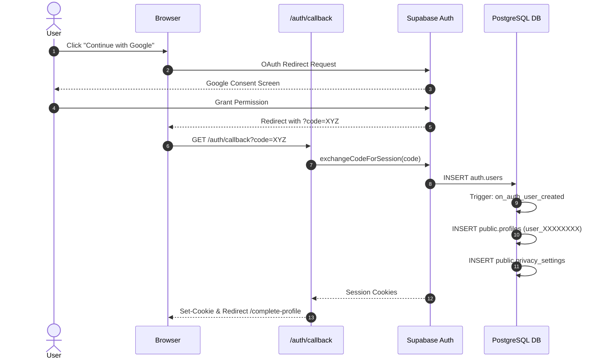
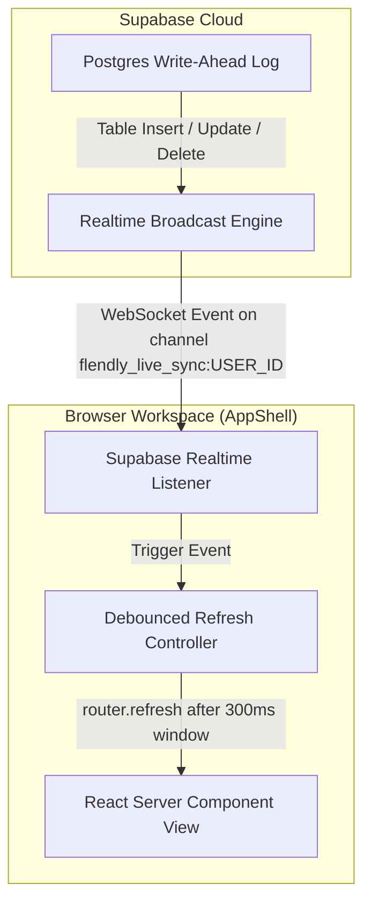
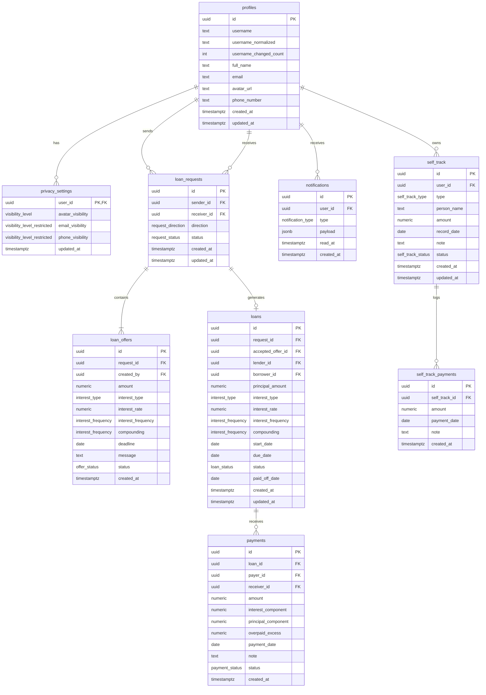

# Flendly — Master Technical & Product Documentation

*Last updated from repository state: October 2026*  
*Repository: [github.com/ankitjana-31/flendly](https://github.com/ankitjana-31/flendly)*  
*Application Name: Flendly (v2.4)*

---

## 1. Executive Summary & Product Architecture

Flendly is a web-based financial ledger and negotiation platform built to manage peer-to-peer debt between friends, roommates, and family members. Informal lending is notoriously vulnerable to social friction: forgotten agreements, lost WhatsApp chat threads, vague verbal repayment dates, and asymmetric recollections of who owes what. 

Flendly replaces this informal ambiguity with structured, mutual records. Rather than functioning as a bank or an automated payments intermediary, Flendly serves as an **authoritative source of truth**. Both parties propose, counter-offer, formally accept, and track offline repayments against an agreed contract. When privacy is preferred for small everyday splits (like cabs, chai, or dinners), Flendly provides a completely isolated, private offline ledger that never pings or notifies the other party.

```
+-------------------------------------------------------------------------------------------------------+
|                                           CLIENT RUNTIME                                              |
|                                                                                                       |
|  Next.js 16 (React 19) App Router  *  Tailwind CSS v4  *  Framer Motion  *  next-themes (5 Palettes)  |
|                                                                                                       |
|  [ Public Routes ]           [ Authenticated Workspace: AppShell ]          [ System Endpoints ]      |
|  * Landing & Diff View       * Dashboard (Net Balance, Active Ledgers)      * /api/cron/reminders     |
|  * Learn More & Anatomy      * Lent Portfolio (/lent)                       * /api/users/search       |
|  * Terms & Privacy           * Borrowed Liabilities (/borrowed)             * /api/self-track         |
|  * Auth (/auth/login)        * Negotiation Cockpit (/requests/[id])         * /auth/callback          |
|  * Onboarding Profile        * Loan Contract & Audit (/loans/[id])                                    |
|                              * Private Offline Ledger (/self-track)                                   |
|                              * Live Notifications Feed (/notifications)                               |
+---------------------------------------------------+---------------------------------------------------+
                                                    |
                                                    | HTTPS Server Actions / PostgREST / Realtime
                                                    v
+-------------------------------------------------------------------------------------------------------+
|                                       SUPABASE BACKEND PLATFORM                                       |
|                                                                                                       |
|  [ PostgreSQL 15 Engine with Row Level Security (RLS) ]                                               |
|  * profiles                 * loan_requests           * loans                 * self_track            |
|  * privacy_settings         * loan_offers             * payments              * self_track_payments   |
|  * notifications                                                                                      |
|                                                                                                       |
|  [ Authoritative PL/pgSQL RPC Stored Procedures ]                                                     |
|  * accept_offer()           * compute_loan_ledger()   * record_payment()      * confirm_payment()     |
|  * decline_request()        * cancel_request()        * update_username()     * send_reminders()      |
|                                                                                                       |
|  [ Automated Lifecycle Triggers ]                     [ Supabase Realtime Engine (WebSockets) ]       |
|  * Profile bootstrap on auth.users insert             * Broadcasts database mutation events           |
|  * Dynamic notification event dispatcher              * Live client sync channel:                     |
|  * 12h / 24h expired request auto-cancellation          `flendly_live_sync:${userId}`                 |
+-------------------------------------------------------------------------------------------------------+
```

---

## 2. Problem Space & Product Philosophy

### 2.1 The Core Problems

1. **The Asymmetric Memory Trap**: Person A remembers lending ₹2,000 for a weekend trip; Person B remembers it as ₹1,500 because Person A forgot to subtract their share of dinner. Neither party has ill intent, but the relationship suffers unnecessary awkwardness.
2. **The Passive Reminder Burden**: In friendship networks, sending a reminder text asking for money feels transactional, confrontational, and uncomfortable. Lenders frequently let debts slide rather than risk appearing petty.
3. **The Overhead of Formal Contracts**: Existing legal contracts or promissory notes are far too heavy-handed for informal friend loans, while general expense splitters (like Splitwise) treat debt as an ongoing communal tab rather than a discrete loan with terms, interest rules, and a fixed repayment target.
4. **The "Chai & Cab" Split vs. Substantial Loans**: People lend money in two distinct contexts:
   - *Micro splits*: Small cash transfers where you simply want to write down a personal note so you don't forget.
   - *Substantial peer loans*: Significant amounts (₹5,000 to ₹1,00,000) with agreed repayment dates and optional interest where both people need to see the exact same contract.

### 2.2 Product Principles

- **Agreement Precedes Contract**: A loan never enters the ledger without explicit, authenticated consent from both participants. One user proposes; the other reviews and either accepts, counters, or declines.
- **Authoritative Server Truth**: Financial interest and payment distributions are never calculated on the client. The browser renders an advisory preview for user convenience, while PostgreSQL functions compute and persist the final numbers with strict numeric precision.
- **Total Ledger Isolation**: Offline tracking (`self-track`) and mutual contracts (`loans`) are kept strictly separated in database tables, business logic, and UI representations. A private record will never send an email, create a notification, or leak to another user.
- **Tactile, Neo-Brutalist Clarity**: Financial software often hides behind sterile corporate minimalism. Flendly adopts a bold, retro-computing operating system aesthetic with high-contrast borders, tactile drop shadows, and distinct color codes for money owed vs. money due.

---

## 3. Implementation Status Registry

Every feature in Flendly is classified according to its concrete state in the codebase:

| Feature / Subsystem | Status | Verification Detail |
| :--- | :--- | :--- |
| Google OAuth Authentication | **Implemented** | Supabase Auth integration via `@supabase/ssr` in `/auth/login` and `/auth/callback`. |
| Username Bootstrap & Onboarding | **Implemented** | Triggers generate random `user_XXXXXXXX` placeholder; `/complete-profile` gates onboarding. |
| User Profile & Privacy Controls | **Implemented** | Configurable visibility for email, phone, and avatar (`everyone`, `participants`, `nobody`). |
| Dual-Sided Loan Proposals | **Implemented** | `/requests/new` supporting both Lend and Borrow directions with live recipient handle search. |
| ₹1,00,000 Proposal Safety Cap | **Implemented** | Enforced at both Zod schema validation layer and PostgreSQL database constraint level. |
| Dynamic 12h / 24h Approval Window | **Implemented** | Enforced in SQL `accept_offer()` and verified via Vitest in `approval-window.test.ts`. |
| Counter-Offer Negotiation Cockpit | **Implemented** | Dynamic thread in `/requests/[id]` allowing users to modify amount, interest, and deadlines. |
| Request Auto-Cancellation | **Implemented** | Database function `auto_cancel_expired_requests()` expires unaccepted proposals past window. |
| Immutable Loan Creation | **Implemented** | Generated through `accept_offer()` stored procedure; creates official loan row with snapshot terms. |
| Advisory Interest Engine | **Implemented** | Pure TypeScript calculation engine in `engine.ts` matching SQL logic, tested with 24 Vitest cases. |
| Two-Phase Repayment Flow | **Implemented** | Borrowers submit payments in `PENDING` state; lenders confirm or reject via authenticated RPCs. |
| Repayment Overpay Guards | **Implemented** | Prevents pending/submitted repayments from exceeding total outstanding ledger balance. |
| Prominent Net Position Cards | **Implemented** | Dedicated summary cards on `/lent` (`TOTAL OWED TO YOU`) and `/borrowed` (`TOTAL YOU OWE`). |
| Private Offline Ledger (Self Track)| **Implemented** | Independent tables (`self_track`, `self_track_payments`) for unshared personal debt records. |
| Realtime Live Synchronization | **Implemented** | Supabase Realtime channel `flendly_live_sync:${userId}` automatically revalidates client views. |
| Multi-Theme Color Engine | **Implemented** | 5 complete themes (`light`, `dark`, `ocean`, `sunset`, `tropical`) with custom `@custom-variant dark`. |
| Daily Deadline Reminders Fallback | **Implemented** | Endpoint `/api/cron/deadline-reminders` gated by bearer token `CRON_SECRET` calling RPC. |
| Integrated Payment Gateway | **Planned** | Money movement currently happens off-platform (UPI/Cash/NEFT); in-app payments are future vision. |
| Social Lending Marketplace | **Planned** | Marketplace discovery, public alias feeds, and borrower underwriting belong to long-term vision. |

---

## 4. Route Inventory & Navigation Map

```
/ (Root)
│
├── Public & Marketing
│   ├── / ........................... Landing page with Hero, System Audit, and Live Diff View
│   ├── /learn-more ................. Product philosophy, interactive loan anatomy, and comparison
│   ├── /learn-more/lending ......... Conceptual guide to informal peer-to-peer lending
│   ├── /terms ...................... Terms of Service and user agreement
│   ├── /privacy .................... Data collection and privacy policy
│   ├── /screens .................... Visual prototype gallery and showcase screens
│   ├── /preview/complete-profile ... Preview route for onboarding screens
│
├── Authentication & Onboarding
│   ├── /auth/login ................. Retro window login page with Google OAuth button
│   ├── /auth/callback .............. Route handler exchanging OAuth code for session cookies
│   ├── /complete-profile ........... Mandatory initial setup route for new users to claim username
│
├── Authenticated Application Workspace (Wrapped in AppShell)
│   ├── /dashboard .................. Financial overview, recent requests, open loans, self-track widget
│   ├── /lent ....................... Receivables portfolio: Total owed to you, active and settled cards
│   ├── /borrowed ................... Payables portfolio: Total you owe, active and settled cards
│   ├── /requests ................... Proposal dashboard with Incoming/Outgoing filter tabs
│   ├── /requests/new ............... Proposal builder (Direction, Counterparty, Principal, Interest, Due Date)
│   ├── /requests/[id] .............. Negotiation Cockpit: Active proposal, terms, counter-offer form, history
│   ├── /loans/[id] ................. Official Loan Ledger: Contract terms, payment history, submit repayment
│   ├── /self-track ................. Private personal records: 4-metric summary, new entry form, repayment logs
│   ├── /notifications .............. Realtime activity feed with unread indicators and direct entity links
│   ├── /profile .................... Public profile view, username display, and financial statistics
│   └── /profile/settings ........... Account configuration: Update username, privacy levels, theme selector
│
└── System & API Route Handlers
    ├── /api/cron/deadline-reminders  Daily cron trigger executing `send_deadline_reminders()` RPC
    ├── /api/users/search ........... Authenticated JSON endpoint for counterparty username search
    └── /api/self-track ............. JSON API for retrieving user-specific offline records
```

---

## 5. Authentication, User Identity & Privacy

### 5.1 Authentication Flow
Flendly uses **Google OAuth** powered by Supabase Auth with PKCE flow in the Next.js App Router:

1. **Initiation**: The user clicks `CONTINUE WITH GOOGLE` on `/auth/login`. The client calls `supabase.auth.signInWithOAuth({ provider: 'google', options: { redirectTo } })`.
2. **Callback Exchange**: Google redirects back to `/auth/callback?code=...`. The route handler (`src/app/auth/callback/route.ts`) invokes `supabase.auth.exchangeCodeForSession(code)` and writes secure, HTTP-only authentication cookies to the browser.
3. **Profile Bootstrap**: When a new record is inserted into `auth.users`, the PostgreSQL trigger `on_auth_user_created` fires automatically (`0006_triggers_profile_bootstrap.sql`). It generates:
   - A row in `public.profiles` with a random unique username format: `user_` + 8 hex characters (e.g., `user_a1b2c3d4`).
   - A companion row in `public.privacy_settings` with secure defaults.



### 5.2 Mandatory Username Onboarding
To prevent users from navigating the application with unreadable generated IDs, the session middleware (`src/lib/supabase/proxy.ts`) checks the username pattern:
```typescript
export function isPlaceholderUsername(username: string | null | undefined) {
  if (!username) return true;
  return Boolean(username.match(/^user_[0-9a-f]{8}$/));
}
```
If a logged-in user possesses a placeholder username and attempts to visit `/dashboard`, `/lent`, `/borrowed`, or any other workspace route, the proxy middleware immediately intercepts the request and redirects them to `/complete-profile`. Here, users pick their permanent, lowercase alphanumeric handle (3–20 characters, matching `^[a-z0-9_]+$`).

### 5.3 Username Modifications & Change Tracking
Users can change their handle later in `/profile/settings`. To prevent impersonation fraud or evasion of debts:
- The database enforces a `username_changed_count` column.
- The stored procedure `update_username(p_new_username)` verifies uniqueness against `username_normalized`, updates the record, and increments `username_changed_count`.
- Profile headers show whether a handle has been modified, preventing bad actors from borrowing money under one name and instantly renaming their account.

### 5.4 Privacy Engine
The `privacy_settings` table regulates field exposure via the stored procedure `get_profile_visible(target_id)`:
- `avatar_visibility`: Can be set to `everyone`, `participants`, or `nobody`.
- `email_visibility` and `phone_visibility`: Restricted to `only_me` or `participants`.
- Users involved in an active loan or request are treated as *participants* and can see contact details needed to arrange offline bank transfers or UPI payments. Non-participants searching the platform see only the handle and full name.

---

## 6. Mutual Lending & The Negotiation Lifecycle

Official loans in Flendly represent binding social agreements between two distinct authenticated accounts. The negotiation workflow ensures both parties have full agency over terms before any balance becomes active.

### 6.1 State Machine

```
                 +-------------------+
                 |      DRAFT        |
                 +---------+---------+
                           |
                     create_request()
                           |
                           v
                 +-------------------+       decline_request()       +-------------------+
  +------------->|      PENDING      |------------------------------>|     DECLINED      |
  |              +---------+---------+                               +-------------------+
  |                        |                                                   ^
  |                  counter_offer()                                           |
  |                        |                                            auto-cancel /
  |                        v                                              decline
  |              +-------------------+                                         |
  +--------------|     COUNTERED     |-----------------------------------------+
                 +---------+---------+
                           |
                     accept_offer()
                           |
                           v
                 +-------------------+
                 |    LOAN ACTIVE    |
                 +---------+---------+
                           |
              record_payment() [PENDING]
                           |
              confirm_payment() [CONFIRMED]
                           |
                  Balance == 0.00
                           |
                           v
                 +-------------------+
                 |    LOAN SETTLED   |
                 +-------------------+
```

### 6.2 Key Negotiation Rules & Safety Constraints

1. **Strict Maximum Amount Cap (₹1,00,000)**:
   - Enforced in the Zod form validation schema: `.max(100000, "Maximum proposal amount is ₹1,00,000 for safety.")`
   - Enforced in database table constraints (`0025_approval_deadlines_and_limits.sql`):
     ```sql
     alter table public.loan_offers
       add constraint loan_offers_amount_max_check
       check (amount > 0 and amount <= 100000.00);
     ```
   - Prevents prank proposals, UI integer overflows, or absurd numbers from polluting database records.

2. **Anti-Spam Rate Limiting**:
   - `createRequestAction` inspects the sender's activity over the previous 10 minutes:
     ```typescript
     const tenMinutesAgo = new Date(Date.now() - 10 * 60 * 1000).toISOString();
     const { count } = await supabase.from("loan_requests")
       .select("id", { count: "exact", head: true })
       .eq("sender_id", user.id)
       .gte("created_at", tenMinutesAgo);
     if (count >= 5) throw new Error("Rate limit reached. Please wait a few minutes.");
     ```

3. **Dynamic 12h / 24h Approval Window**:
   - Proposals cannot linger indefinitely. An unaccepted proposal is automatically expired and cancelled:
     - **12 Hours**: When the agreed repayment deadline is within 1 or 2 days of creation.
     - **24 Hours**: For all loans with repayment horizons greater than 2 days.
   - The approval deadline can never exceed the repayment deadline date itself.
   - Verified by unit tests in `src/lib/requests/approval-window.test.ts`.
   - The PostgreSQL stored procedure `accept_offer()` verifies `now() <= approval_deadline` using `SELECT ... FOR UPDATE` row locks; if expired, it rejects the transaction and transitions the request to `CANCELLED`.

4. **Counter-Offers**:
   - When a counterparty counters a proposal, the previous offer status changes to `SUPERSEDED`.
   - The new offer becomes the single `ACTIVE` offer.
   - The request status updates to `COUNTERED`. The ball is placed back in the originator's court.

---

## 7. Loan Execution, Interest Mechanics & Settlement

When `accept_offer(p_offer_id)` is invoked:
1. It validates authentication and checks that the caller is the legitimate recipient of the active offer.
2. It locks the request and offer rows.
3. It sets `loan_requests.status = 'ACCEPTED'` and `loan_offers.status = 'ACCEPTED'`.
4. It resolves which party is the `lender` and who is the `borrower` based on `request.direction` (`lend` vs `borrow`) and who created the proposal.
5. It inserts an immutable row into `public.loans`, recording `principal_amount`, `interest_type`, `interest_rate`, `interest_frequency`, `compounding`, `start_date` (current date), and `due_date`.
6. It triggers an `offer_accepted` notification to both participants and returns the new `loan_id`.

### 7.1 Authoritative PL/pgSQL Interest Engine
Financial calculations in Flendly are executed inside `compute_loan_ledger(p_loan_id, p_as_of)` (`0015_fn_compute_and_get_loan_ledger.sql` and `0021_payment_approval_flow.sql`).

#### Algorithm Walkthrough:
1. **Calendar Periods Walk**: The database measures time not through crude 30-day assumptions, but by walking calendar periods forward from `start_date` (`calendar_periods_elapsed`).
2. **Segmented Accrual**:
   - For every confirmed payment in chronological order:
     - Accrue interest on the current outstanding principal from the last anchor date up to `payment_date`.
     - Allocate payment amount first to clear all accrued unpaid interest.
     - Allocate the remainder of payment to reduce principal.
     - Any excess beyond total balance is labeled `overpaid_excess`.
     - Update the anchor date to `payment_date`.
3. **Tail Accrual**:
   - Accrue interest on remaining principal from the last payment date up to `p_as_of` (or up to `paid_off_date` if the loan was already cleared).
4. **Rounding**: All final currency outputs are rounded to two decimal places (`numeric(12, 2)`).

### 7.2 TypeScript Advisory Engine (`src/lib/interest/engine.ts`)
To give borrowers instant feedback on the payment form without round-tripping to PostgreSQL on every keystroke, Flendly contains an exact TypeScript mirror using `decimal.js`.
- It executes pure, side-effect-free math (`accrueSimpleInterest`, `accrueCompoundInterest`, `computeLedger`, `previewPayment`).
- It models calendar day-differencing in UTC to prevent daylight saving distortions.
- It displays a live breakdown: *"₹500 payment: ~₹42 to unpaid interest, ~₹458 to principal reduction."*
- **Crucial Security Boundary**: The values returned by the TypeScript engine are purely advisory. When the form is submitted, the server action `recordPaymentAction` discards all client math and passes only the raw `amount` and `paymentDate` to PostgreSQL for authoritative recalculation.

### 7.3 Two-Phase Payment Confirmation Flow
Informal loan repayments can cause disputes if a borrower claims they handed over cash or sent a UPI transfer that the lender never received. Flendly solves this with a two-phase approval protocol:

1. **Submission (`PENDING`)**:
   - The borrower records a payment via `record_payment(p_loan_id, p_amount, p_payment_date, p_note)`.
   - The payment is inserted into `public.payments` with `status = 'PENDING'`.
   - `compute_loan_ledger()` **excludes** `PENDING` payments from balance reductions.
   - The lender receives a `payment_recorded` notification.
2. **Double-Payment Guard**:
   - `recordPaymentAction` checks total pending payments against remaining balance. If a payment is already pending that covers the rest of the loan, no further payments can be entered until the lender acts.
3. **Confirmation (`CONFIRMED`)**:
   - The lender reviews the payment in `/loans/[id]`.
   - Clicking `CONFIRM PAYMENT` triggers `confirm_payment(p_payment_id)`.
   - The payment status transitions to `CONFIRMED`.
   - The ledger recomputes. If `principal_remaining == 0` and `unpaid_interest == 0`, the loan automatically updates to `status = 'PAID'` and sets `paid_off_date = current_date`.
4. **Rejection (`REJECTED`)**:
   - If the lender never received the transfer, they click `REJECT PAYMENT` (`reject_payment(p_payment_id)`).
   - The payment row status is updated to `REJECTED`, and the borrower is alerted.

---

## 8. Self Track: Private Offline Ledger

Flendly provides two distinct modes of debt management. While official loans require counterparty accounts, negotiations, and confirmations, **Self Track** is designed for the dozens of informal, daily transactions that occur in real life:

| Dimension | Official Loans (`/loans`) | Self Track (`/self-track`) |
| :--- | :--- | :--- |
| **Counterparty** | Must be an authenticated Flendly user. | Arbitrary text name (e.g., "Rahul", "Pooja Chai"). |
| **Notifications** | Alerts sent on creation, updates, and payments. | **Zero notifications.** 100% silent and private. |
| **Data Visibility** | Shared between lender and borrower. | Enforced by RLS: readable only by `auth.uid() = user_id`. |
| **Interest Rules** | None, Simple, or Compound interest supported. | Non-interest principal tracking only. |
| **Repayment Model**| Two-phase submission + lender confirmation. | Immediate one-click entry and settlement. |
| **Primary Use Case**| Significant loans, rent splits, equipment borrowing. | Quick chai tabs, auto rickshaw fares, dinner splits. |

### 8.1 Database Architecture (`0022_self_track_feature.sql`)
- `self_track`: Records `user_id`, `type` (`lent` | `borrowed`), `person_name`, `amount`, `record_date`, `note`, and `status` (`active` | `settled`).
- `self_track_payments`: Tracks partial repayments with `self_track_id`, `amount`, `payment_date`, and `note`.
- Cascading deletes ensure deleting a record purges all associated payment logs cleanly.

### 8.2 Client-Side Optimistic UI
The `SelfTrackList` and `SelfTrackForm` components utilize optimistic state updates with Framer Motion:
- Toggling status (`active` ↔ `settled`) or deleting a record updates local React state instantly, displaying a tactile toast alert while the server action runs asynchronously.
- If the network fails, the state safely rolls back to previous records.

---

## 9. Realtime Synchronization Architecture

Flendly implements real-time page updates using **Supabase Realtime WebSockets** so that both lenders and borrowers see updates instantly without manually refreshing their browsers.



### 9.1 Connection & Authentication
In `src/components/layout/app-shell.tsx`:
1. The client monitors session changes via `supabase.auth.onAuthStateChange`. When an access token is available, it registers with the realtime socket:
   ```typescript
   void supabase.realtime.setAuth(session.access_token);
   ```
2. A single multiplexed channel is created for the authenticated user:
   ```typescript
   const channelName = `flendly_live_sync:${userId}`;
   ```

### 9.2 Event Subscriptions
The channel listens to Postgres mutation events across 6 distinct tables:
- `notifications`: Tracks new incoming alerts and increments/decrements unread badge counters.
- `loans`: Filtered on `lender_id=eq.${userId}` and `borrower_id=eq.${userId}` to capture loan creation and status changes.
- `payments`: Filtered on `payer_id=eq.${userId}` and `receiver_id=eq.${userId}` to reflect repayment submissions and confirmations.
- `loan_requests`: Filtered on `sender_id=eq.${userId}` and `receiver_id=eq.${userId}` to update proposal statuses.
- `loan_offers`: Listens to counter-offers and superseded proposals.
- `self_track` and `self_track_payments`: Captures private ledger changes across tabs or devices.

### 9.3 Debounced Refresh Strategy
Rapid events (such as multiple payments confirmed in quick succession) do not trigger multiple server queries. The client uses a debounced controller:
```typescript
const triggerDebouncedRefresh = () => {
  if (refreshTimeoutRef.current) clearTimeout(refreshTimeoutRef.current);
  refreshTimeoutRef.current = setTimeout(() => {
    router.refresh();
  }, 300);
};
```
This re-runs Next.js server components, fetching fresh data cleanly and streaming the rendered diff down to the client.

---

## 10. Complete Database Schema & Migrations

The database is built on PostgreSQL with Row Level Security (RLS) enabled across every table.



### 10.1 Enumerations
- `request_direction`: `'lend'`, `'borrow'`
- `request_status`: `'PENDING'`, `'COUNTERED'`, `'ACCEPTED'`, `'DECLINED'`, `'CANCELLED'`
- `offer_status`: `'ACTIVE'`, `'SUPERSEDED'`, `'ACCEPTED'`, `'DECLINED'`
- `interest_type`: `'none'`, `'simple'`, `'compound'`
- `interest_frequency`: `'daily'`, `'monthly'`, `'yearly'`
- `loan_status`: `'ACTIVE'`, `'PAID'`
- `payment_status`: `'PENDING'`, `'CONFIRMED'`, `'REJECTED'`
- `visibility_level`: `'everyone'`, `'participants'`, `'nobody'`
- `visibility_level_restricted`: `'only_me'`, `'participants'`
- `self_track_type`: `'lent'`, `'borrowed'`
- `self_track_status`: `'active'`, `'settled'`
- `notification_type`: `'new_request'`, `'counter_offer'`, `'offer_accepted'`, `'offer_declined'`, `'payment_recorded'`, `'deadline_reminder'`, `'overdue'`, `'fully_paid'`

### 10.2 Database Migrations Log (0001–0027)

| Migration File | Primary Functional Responsibility |
| :--- | :--- |
| `0001_enums.sql` | Declares fundamental domain enums (interest types, directions, statuses). |
| `0002_tables_profiles_privacy.sql` | Creates `profiles` and `privacy_settings` tables with normalization triggers. |
| `0003_tables_requests_offers.sql` | Establishes `loan_requests` and `loan_offers` for proposal threads. |
| `0004_tables_loans_payments.sql` | Creates official `loans` and `payments` tables with foreign keys and check constraints. |
| `0005_tables_notifications.sql` | Creates `notifications` table storing structured JSONB event payloads. |
| `0006_triggers_profile_bootstrap.sql` | Attaches trigger to `auth.users` to initialize profile and privacy rows on registration. |
| `0007_triggers_updated_at.sql` | Implements automated `updated_at = now()` timestamps across all state tables. |
| `0008_rls_profiles_privacy.sql` | Configures RLS policies for profiles and visibility-restricted user settings. |
| `0009_rls_requests_offers.sql` | Locks request/offer reads and writes to participating senders and receivers. |
| `0010_rls_loans_payments_notifications.sql` | Enforces that only lenders and borrowers can view and mutate their loan ledgers. |
| `0011_fn_get_profile_visible.sql` | Stored procedure resolving profile fields according to viewer relationship. |
| `0012_fn_update_username.sql` | Enforces validation, uniqueness, and increments `username_changed_count`. |
| `0013_fn_search_users.sql` | Prefix and ILIKE search returning verified usernames for autocomplete. |
| `0014_fn_accept_offer.sql` | Transactional stored procedure transitioning offer to an immutable loan row. |
| `0015_fn_compute_and_get_loan_ledger.sql`| Core calendar-accurate PL/pgSQL interest and principal amortization engine. |
| `0016_fn_record_payment.sql` | Stores payment records, computes interest allocations, and triggers notifications. |
| `0017_fn_request_lifecycle.sql` | Helper procedures for proposal creation, cancellation, and rejection. |
| `0017_triggers_notifications_domain_events.sql` | Dispatches automated notifications on database domain mutations. |
| `0018_cron_deadline_reminders.sql` | Schedules daily deadline and overdue alert checks via `pg_cron`. |
| `0019_fn_update_profile_details.sql` | Procedure updating user's full name and phone number. |
| `0019_grant_profiles_update.sql` | Grants authenticated users execution rights on profile updates. |
| `0020_decline_cancel_loan_requests.sql` | Stored procedures enabling decline and cancellation of proposals. |
| `0021_payment_approval_flow.sql` | Upgrades payments to two-phase flow (`PENDING` → `CONFIRMED`/`REJECTED`). |
| `0022_self_track_feature.sql` | Establishes independent `self_track` and `self_track_payments` tables with RLS. |
| `0023_enable_realtime_notifications.sql`| Adds `notifications` table to `supabase_realtime` publication. |
| `0024_auto_cancel_expired_requests.sql` | Stored procedure auto-cancelling requests past their deadlines. |
| `0025_approval_deadlines_and_limits.sql`| Enforces ₹1,00,000 max amount constraint and 12h/24h approval windows. |
| `0026_enable_realtime_all_tables.sql` | Extends realtime publication to `loans`, `payments`, `requests`, and `offers`. |
| `0027_fix_realtime_tables.sql` | Ensures `self_track` and `self_track_payments` are enabled in realtime publication. |

---

## 11. Design System & Frontend Architecture

Flendly's user interface is styled in a **Neo-Brutalist Retro OS** visual theme. The interface takes cues from classic operating systems (sharp borders, functional titlebars, high-contrast badges) combined with modern responsive typography and smooth framer-motion micro-interactions.

### 11.1 Color Palette & Theme Tokens
The theme engine is powered by `next-themes` and configured in `src/app/globals.css`. Five switchable themes are supported:

| Theme Token | Light Mode (Default) | Dark Mode | Ocean | Sunset | Tropical |
| :--- | :--- | :--- | :--- | :--- | :--- |
| **`--background`** | `#FAF8F5` (Warm Cream)| `#0F1117` (Terminal) | `#071827` (Navy Abyss)| `#24121D` (Burgundy) | `#062522` (Deep Lagoon) |
| **`--card`** | `#FFFFFF` | `#161821` | `#0D2437` | `#3A1D2B` | `#0B3D39` |
| **`--muted`** | `#F5F2EB` | `#1E212D` | `#123A52` | `#54283A` | `#12544D` |
| **`--foreground`** | `#000000` | `#F1F5F9` | `#E6F7FF` | `#FFF4E6` | `#E6FFFA` |
| **`--muted-foreground`**| `#4B5563` | `#9CA3AF` | `#A8D0E1` | `#F4C6B5` | `#A7E5D9` |
| **`--primary`** | `#2563EB` (Brand Blue)| `#3B82F6` | `#38BDF8` | `#FDE047` | `#2DD4BF` |
| **`--accent`** | `#FFE600` (Yellow) | `#FFE600` | `#67E8F9` | `#FDE047` | `#A3E635` |

#### Tailwind v4 Custom Dark Variant
Because `next-themes` applies class names matching `.ocean`, `.sunset`, and `.tropical` directly to the `<html>` root element, Tailwind v4's default dark mode selector is customized in `globals.css`:
```css
@custom-variant dark (&:where(.dark, .dark *, .ocean, .ocean *, .sunset, .sunset *, .tropical, .tropical *));
```
This guarantees that all utility classes prefixed with `dark:` automatically resolve against the active dark surface across all four dark themes without requiring separate CSS declarations.

### 11.2 Core Reusable Components

- **`RetroWindow` (`src/components/ui/retro-window.tsx`)**:
  - The signature container component across Flendly.
  - Features an OS-style titlebar with configurable color accent bars (`yellow`, `blue`, `pink`, `green`, `dark`).
  - Supports tactile window control buttons: minimize (`_`), maximize (`□`), and close (`✕`).
  - Includes an optional outer edge glow highlight (`glow={true}`) used on active debt cards.
- **`CursorGlow` (`src/components/ui/cursor-glow.tsx`)**:
  - Spring-animated trailing ambient light following mouse coordinates across desktop viewports.
  - Automatically adjusts opacity and blend modes based on whether light or dark mode is active.
- **`StatusBadge` (`src/components/ui/status-badge.tsx`)**:
  - High-contrast pill indicators displaying status states (`ACTIVE`, `PENDING`, `SETTLED`, `OVERDUE`).
- **`AppShell` (`src/components/layout/app-shell.tsx`)**:
  - Authenticated layout frame providing a persistent desktop sidebar, responsive top navigation, real-time unread counter, and a mobile bottom navigation bar.

---

## 12. Security Architecture & Threat Model

1. **Strict PostgreSQL Row Level Security (RLS)**:
   - RLS is enabled on all application tables.
   - Even if a malicious client bypasses the Next.js API layer and connects directly to the Supabase PostgREST endpoint with a valid user token, they can only read and mutate rows where `auth.uid()` matches their participant ID.
2. **Server-Side Authorization in Server Actions**:
   - Every server action (`createRequestAction`, `acceptOfferAction`, `recordPaymentAction`, `confirmPaymentAction`) starts by verifying `await supabase.auth.getUser()`.
   - Actions re-query participant IDs from the database before executing operations; client-provided user IDs are discarded.
3. **Database Function Privileges**:
   - Privileged operations (`accept_offer`, `confirm_payment`, `compute_loan_ledger`) are marked `SECURITY DEFINER` with fixed `search_path = public` to prevent search path hijacking.
   - Public execute privileges are revoked and granted strictly to `authenticated` and `service_role`.
4. **Environment Secrets Isolation**:
   - Handled via `src/lib/env.ts` using strict Zod parsing.
   - Only `NEXT_PUBLIC_SUPABASE_URL`, `NEXT_PUBLIC_SUPABASE_PUBLISHABLE_KEY`, and `NEXT_PUBLIC_SITE_URL` are exposed to the client bundle.
   - `SUPABASE_SERVICE_ROLE_KEY` and `CRON_SECRET` are strictly validated on the server and never referenced in client components.
5. **Denial-of-Service & Input Safeguards**:
   - Maximum loan amount capped at ₹1,00,000.
   - Message and note lengths capped at 500 characters.
   - Rate limit of 5 new proposals per 10 minutes per user.

---

## 13. Testing Suite & Verification

The test suite runs on **Vitest 4.1** (`npm test`) with 30 automated unit tests:

```
 RUN  v4.1.11

 ✓ src/lib/requests/approval-window.test.ts (2 tests)
 ✓ src/lib/interest/engine.test.ts (24 tests)
 ✓ src/lib/requests/security-safety.test.ts (4 tests)

 Test Files  3 passed (3)
      Tests  30 passed (30)
```

### Coverage Details:
1. **`src/lib/interest/engine.test.ts` (24 tests)**:
   - Verifies calendar day walks (`calendarPeriodsElapsed`) across leap years and month boundaries.
   - Validates simple interest accrual against fixed mathematical formulas.
   - Tests compounding interest across daily, monthly, and yearly intervals.
   - Tests complete loan ledgers (`computeLedger`) with multiple interleaved partial payments.
   - Verifies that payments accurately clear interest before reducing principal.
   - Validates that overpayments are isolated to `overpaidExcess`.
2. **`src/lib/requests/approval-window.test.ts` (2 tests)**:
   - Tests that 1-day and 2-day loans assign exactly a 12-hour approval window.
   - Tests that 3+ day loans assign a 24-hour approval window.
   - Verifies countdown string formatting (`EXPIRED`, `Xh Ym left`).
3. **`src/lib/requests/security-safety.test.ts` (4 tests)**:
   - Verifies acceptance of valid proposals up to ₹1,00,000.
   - Asserts strict rejection of amounts exceeding ₹1,00,000.
   - Asserts strict rejection of zero and negative values.
   - Verifies rejection of message payloads exceeding 500 characters.

---

## 14. Setup, Environment & Deployment Guide

### 14.1 Prerequisites
- Node.js 20+
- A Supabase project with PostgreSQL 15+
- A Google Cloud Console project with OAuth 2.0 Credentials enabled

### 14.2 Environment Variables Configuration
Create a `.env.local` file in the project root:

```bash
# Public variables (exposed to browser client)
NEXT_PUBLIC_SUPABASE_URL=https://your-project.supabase.co
NEXT_PUBLIC_SUPABASE_PUBLISHABLE_KEY=your-supabase-anon-key
NEXT_PUBLIC_SITE_URL=http://localhost:3000

# Server-only variables (never expose to client)
SUPABASE_SERVICE_ROLE_KEY=your-supabase-service-role-key
CRON_SECRET=your-random-generated-secret-string
```

### 14.3 Database Setup
Execute the SQL migrations in `supabase/migrations/` in numerical order (0001 through 0027) via the Supabase SQL Editor or Supabase CLI (`supabase db push`).

### 14.4 Google OAuth Setup
1. In the Google Cloud Console, add `https://<your-project-id>.supabase.co/auth/v1/callback` to **Authorized Redirect URIs**.
2. In Supabase Dashboard → **Authentication** → **Providers** → **Google**:
   - Enable Google.
   - Paste Client ID and Client Secret.

### 14.5 Local Development & Build Commands
```bash
# Install dependencies
npm install

# Run development server with Turbopack
npm run dev

# Run automated Vitest test suite
npm test

# Run TypeScript typecheck
npm run typecheck

# Run production build (Next.js 16)
npm run build
```

---

## 15. The Long-Term Vision: Social Lending Discovery Marketplace

While Flendly today operates as a structured ledger and repayment confirmation tool between individuals who already know each other, the foundational architecture can naturally expand into a **social lending discovery marketplace**.

```
+-----------------------------------------------------------------------------------------------+
|                                      THE LONG-TERM VISION                                     |
|                                                                                               |
|  [ Discovery Feed ]              [ Transparent Underwriting ]     [ Payment Integration ]     |
|  * Verified funding requests     * Historical repayment rate      * Escrow disbursements      |
|  * Filter by duration & amount   * Public pseudonymous alias      * Scheduled e-mandates      |
|  * Lender proposal comparison    * Endorsements & social graph    * Automatic settlement      |
|                                                                                               |
|                         [ Compliance & Regulatory Framework ]                                 |
|                         * KYC / AML identity verification checks                              |
|                         * Non-banking financial regulatory adherence                          |
|                         * Legally binding digital agreements                                  |
+-----------------------------------------------------------------------------------------------+
```

### 15.1 Core Concepts of the Envisioned Marketplace

1. **The Discover Feed**:
   - Borrowers seeking capital for specific personal, creative, or business needs could publish funding requests to an opt-in Discover feed.
   - Lenders browse open requests and propose competing terms: amount, interest rate, duration, and repayment schedule.
2. **Negotiation & Offer Comparison**:
   - The borrower receives multiple offers from potential lenders, compares them side-by-side, negotiates counter-terms, and selects the most favorable proposal.
3. **Privacy, Public Aliases & Verified Identity**:
   - To protect personal privacy in an open network, users interact using public aliases and verified credentials.
   - Full legal identity verification (KYC/AML) remains private, surfaced only under verified dispute resolution or compliance requirements.
4. **Repayment Tracking & Trust Score**:
   - On-time settlements build a transparent reputation score on the platform, establishing credible social creditworthiness without traditional credit bureau friction.
5. **Integrated Payment & Disbursement Escrow**:
   - Integration with authorized payment gateways or banking APIs to disburse approved funds directly to the borrower's account and collect scheduled repayments via automated mandates (e.g., e-NACH / UPI AutoPay).
6. **Compliance & Legal Governance**:
   - Real-money marketplace operations require formal adherence to local peer-to-peer lending regulations, money transmission licensing, and transparent risk disclosures.

*Note: The features outlined in this vision section represent potential future evolution and are not currently active in the codebase.*
